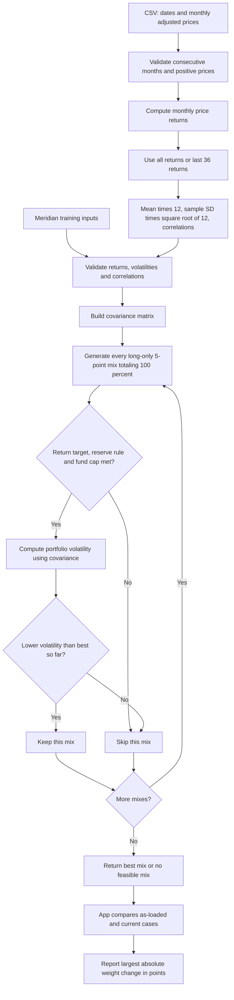

# Lab 15 - Portfolio Stability Decision

QQQ - Tracks the NASDAQ 100: large companies with tech exposure.
SPY - Tracks the S&P 500 large U.S. companies across multiple sectors
TLT - long-term U.S. treasury bonds with more than 20 years remaining.

## Decision question

Which mix carries the least risk while meeting the mandate, and does the answer survive a one-point change in one estimate?

Built with AI help, a learning demonstration, not investment advice.

## Run the app

From the repository root:

```powershell
py -m pip install -r python/requirements-lab15.txt
py python/portfolio.py
py -m streamlit run python/app.py
```

Reproduce the tests with `py python/verify_portfolio.py` and `py python/verify_lab15.py`.

## Meridian verification

The objective is 6.5%, based on the labelled CPI estimate of 2.5% plus 4%. Reserve-eligible weight must be at least 3%. Bills and the 10-year note qualify. The search evaluates long-only weights totaling 100% in 5-percentage-point steps.

| Run | Bills / 10-year / IG / equity (%) | Expected return | Volatility | Reserve eligible |
|---|---|---|---|---|
| As loaded | 0 / 20 / 25 / 55 | 6.51% | 9.44% | 20.00% |
| Equity expected return reduced from 8% to 7% | 0 / 10 / 10 / 80 | 6.53% | 12.94% | 10.00% |
| IG-equity correlation raised from 0.25 to 0.50 | 0 / 40 / 0 / 60 | 6.52% | 9.73% | 40.00% |

The one-point equity return reduction moves equity from 55% to 80%: the largest absolute weight change is **25 percentage points**. The objective and reserve requirement are unchanged. The search needs more equity to clear the same return hurdle when its estimated return falls. The correlation experiment changes both symmetric cells; the original 0.25 inputs are restored afterward.

The program finds the lowest-risk feasible mix on the specified grid, not a continuous optimum and not a guarantee of future returns or full mandate compliance.

## Engine flowchart



Drawing looks kind of like this:

Load monthly adjusted prices from prices.csv
>
Calculate monthly percentage returns
>
choose all months or the last 36
>
Estimate annual returns, volatilities, and correlations
>
Build the covariance matrix
>
Try every long-only mix in 5 point steps, weights totaling 100%
>
Keep mixes meeting the return objective, reserve rule, and per-fund cap
>
Calc each feasible mix's volatilit
>
Choose mix with the lowest volatility.
>
Show weight, return, volatility, and reverse eligible weight.

## Explain portfolio return part of the code

I calculated my portfolio return by taking the weighted average of the assets' expected returns.
The function pairs each assets weight with its expected return , multiplies them, and adds the contributions.

def expected_return(weights, sleeves): defines a function that takes the portfolio weights and asset information.

Correlation affects how we calculate portfolio risk. Expected return only needs the weights and each asset's expected return.

## Project 2 mandate

The Lab 13 mandate describes a $100,000 retirement portfolio with a 20-year horizon, no expected withdrawals and a separate emergency fund. Its target is CPI plus 3% annually, net of costs, over rolling five-year periods. Using a labelled 2.5% CPI assumption gives a **5.5% annual expected-return objective** for this exercise. The app does not model future inflation or separately subtract trading/advisory costs; historical fund prices reflect fund expenses, and the arithmetic annual estimate is not a five-year net-return guarantee.

The search enforces fully invested, long-only weights and a **40% maximum per fund**. No reserve minimum is stated for this portfolio, so the reserve minimum is zero. At least 95% redeemability within five business days must be confirmed separately; an adjusted-price file cannot prove it. Annual rebalancing, suitability and the other mandate provisions are not guaranteed by this grid search.

Proposed course-example universe, subject to student confirmation:

| Ticker | Fund | Role | Yahoo Finance source |
|---|---|---|---|
| BIL | State Street SPDR Bloomberg 1-3 Month T-Bill ETF | Cash and reserve | https://finance.yahoo.com/quote/BIL/history/ |
| IEF | iShares 7-10 Year Treasury Bond ETF | Government bonds | https://finance.yahoo.com/quote/IEF/history/ |
| LQD | iShares iBoxx $ Investment Grade Corporate Bond ETF | Investment-grade fixed income | https://finance.yahoo.com/quote/LQD/history/ |
| VT | Vanguard Total World Stock ETF | Broad global equity | https://finance.yahoo.com/quote/VT/history/ |

Return inputs estimated from prices are **historical arithmetic estimates, not forecasts**. Annual expected return is monthly mean times 12. Annual volatility is sample monthly standard deviation times the square root of 12. Correlations use the same aligned monthly returns. The last-36 switch selects exactly 36 returns, requiring 37 prices.

The completed download and computed Project 2 results appear below. No invented prices or partner observations are used.

## Estimation risk

Estimation risk is the risk that the return, volatility or correlation numbers used in a decision differ from the values that will occur. An optimizer treats those inputs as if they were precise. A small return change can move a portfolio across the feasibility boundary, making the previous allocation unacceptable and selecting a very different one. A 5-point grid can make these changes discrete.

Meridian illustrates this: reducing equity's return estimate by one point raises its required weight by 25 points and raises portfolio volatility from 9.44% to 12.94%. The optimizer is responding to the unchanged target; it is not evidence that equity became safer.


> Estimate changed: I lowered VT's expected annual return by 1 percentage point, from about 11.9%-10.9%, using all five years of data. When these tests were ran the expected portfolio return fell from 5.84% to 5.54% and volatility rose from 7.08% to 7.37%. The largest weight change was 10%.

I would put this mix as my Project 2 starting allocation. Lowering VT's expected return by one percentage point changed the largest weight by 10 points, while using only the last 36 months changed it by 30 points. That sensitivity makes me hesitant to adopt it right away. I would consider adopting it if additional estimation windows and stress tests produced reasonably consistent allocations and I confirmed that the portfolio meets the liquidity requirements and return objective after costs.

> I pilot this starting allocation because changing the estimation window moved the largets weight by 30 percentage points, showing that the mix is sensitive to its inputs. I would change that decision to adopt if further stress tests and estimation windows produced reasonably consistent allocation an the mix met my mandate after costs.

Ethan did not use his meridian securities, he used VOO, QQQ, SOXX, SCHD, BIL, and BND.
## Computed Project 2 results

Downloaded October 22, 2026 (UTC timestamp in `data/prices_sources.json`). Each ticker in the universe table above uses that download date. Source: Yahoo Finance Adj Close, downloaded with `yfinance`, preserving raw daily observations in `data/*_yahoo_daily.json`. The last trading day's adjusted price in each completed month is retained. The CSV covers September 2021 through September 2026: 61 prices producing 60 monthly returns. October 2026 is excluded because it is incomplete. No prices were filled or invented.

The as-loaded case uses all 60 returns. The alternate case uses the final 36 returns. Both retain the 5.5% target and 40% per-fund cap; reserve minimum is zero. Weights are BIL / IEF / LQD / VT.

| Run | Weights (%) | Expected annual return | Annual volatility |
|---|---|---|---|
| All months | 40.00 / 20.00 / 0.00 / 40.00 | 5.84% | 7.08% |
| Last 36 months | 40.00 / 35.00 / 15.00 / 10.00 | 5.57% | 4.28% |
| All months; VT return estimate minus 1 point | 40.00 / 10.00 / 10.00 / 40.00 | 5.54% | 7.37% |

Largest all-months versus 36-month change: **30.00 percentage points**.

Largest one-point VT stress change: **10.00 percentage points**.

| Fund | All-month return estimate | All-month volatility | 36-month return estimate | 36-month volatility |
|---|---|---|---|---|
| BIL | 3.59% | 0.51% | 4.37% | 0.21% |
| IEF | -1.79% | 7.65% | 3.07% | 6.66% |
| LQD | -0.81% | 9.79% | 4.84% | 7.82% |
| VT | 11.90% | 14.92% | 20.25% | 11.71% |
